# LiquidGlass

Liquid Glass for Swift, on every macOS from **Ventura (13) up**.

Apple's `glassEffect` and `GlassEffectContainer` only exist from macOS 26. This
package gives you the same material — refraction, blur, chromatic dispersion,
bevel lighting, edge highlight, specular, tint — on Ventura through macOS 15,
and passes through to the real system APIs when they are available.

The optics are a faithful port of [@ybouane/liquidglass](https://github.com/ybouane/liquidglass),
the WebGL library that drives <https://liquid-glass.ybouane.com/>. Every shader
constant, every `GlassConfig` default, and the browser's stacking-context
compositing rule were ported rather than re-invented, and the port is verified
against the reference renderer pixel by pixel.

```swift
import SwiftUI
import LiquidGlass

Text("Hello")
    .padding()
    .liquidGlass(.regular, in: .capsule)

Button("Confirm") {}
    .buttonStyle(.liquidGlassProminent)
```

---

## Screenshots

All of these are real output from the shipping renderer — `liquidglass-render`
paints the same optical model the SwiftUI layer uses. Nothing here is a mock-up.
Regenerate them with:

```bash
swift run -c release liquidglass-render --all --out-dir docs/screenshots
python3 scripts/make-contact-sheet.py          # needs Pillow
```

### Everything at a glance

Twelve scenes, all rendered by `liquidglass-render`:

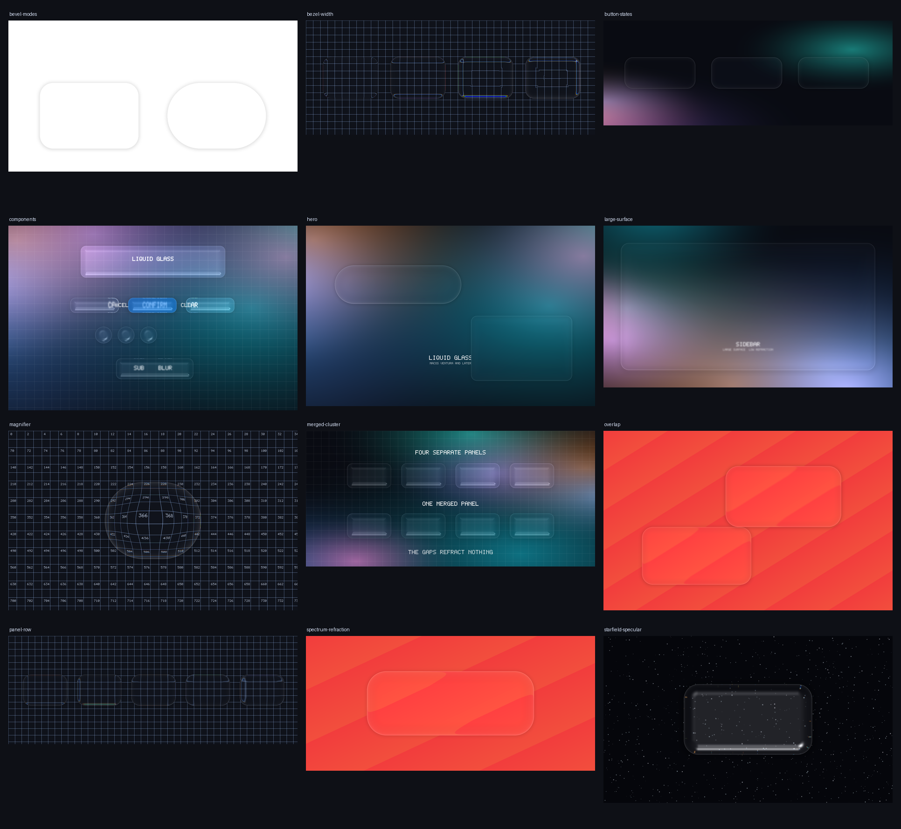

### The SwiftUI component set

The title surface, the three button styles, circular icon buttons, and chips,
over a Ventura mesh gradient with a fine grid behind the glass. This is the
layout the demo app uses.

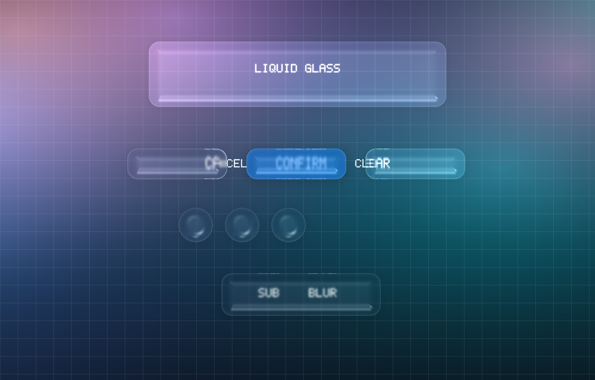

### What the container does to a group

Top row: four separate surfaces. Bottom row: the same four controls inside a
`GlassEffectContainer`, drawn as one panel spanning the group. The bevel runs
around the outside of the group instead of restarting at each control, and the
gaps between the controls refract as glass rather than showing the background.

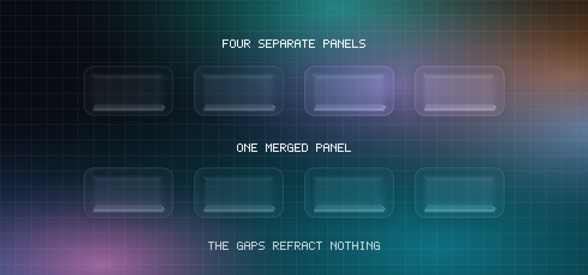

### Hero: a pill and a card

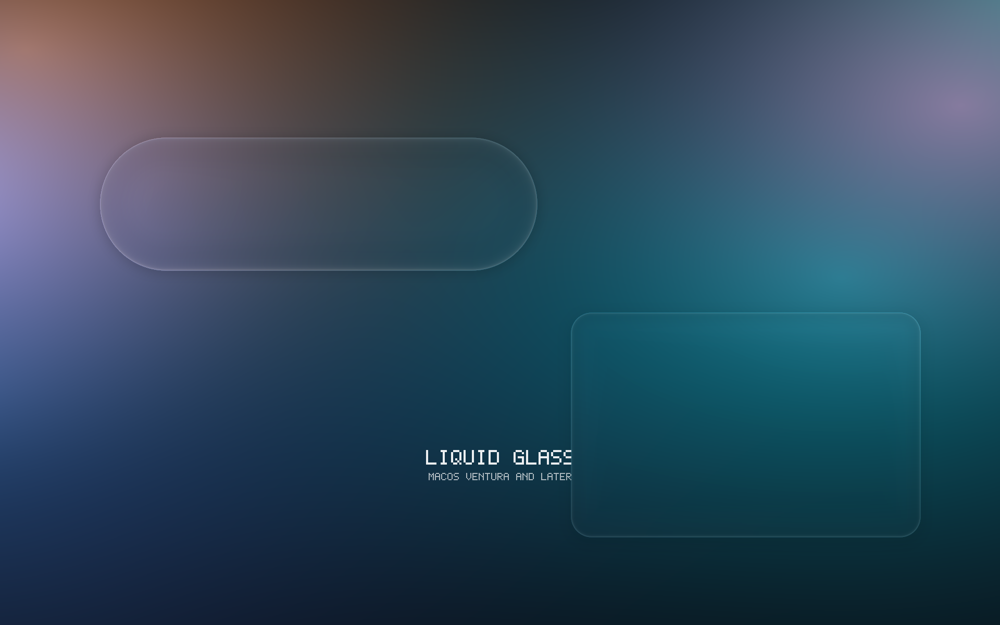

### Buttons: idle, hover, press

The press state flattens the bevel and deepens the shadow, exactly as the
reference library does.

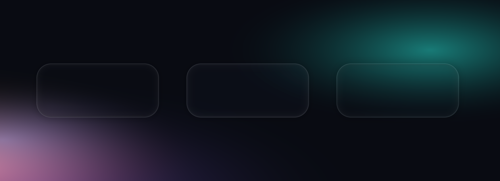

### Refraction strength sweep

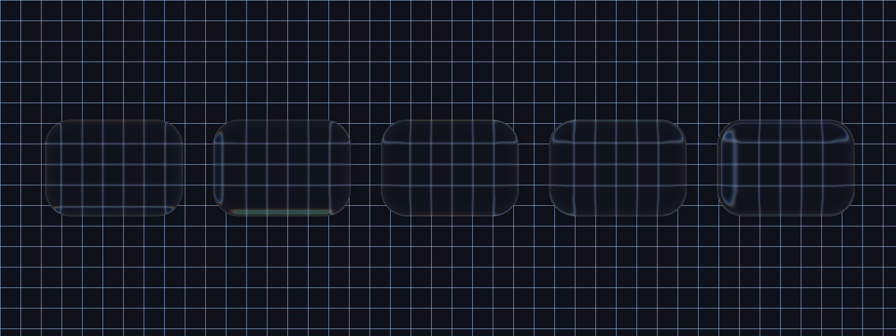

### Bevel depth sweep

The same content seen through bevels from 8 pt to 74 pt deep.

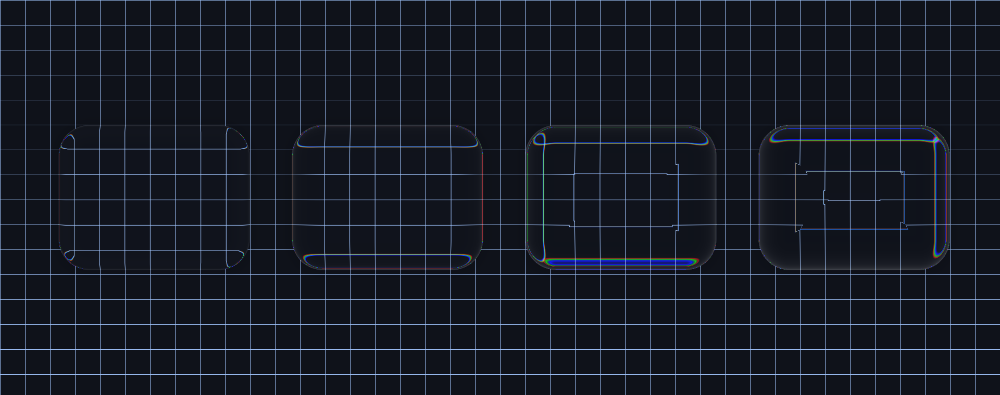

### Chromatic dispersion

Colour fringing where the surface turns away from the viewer.

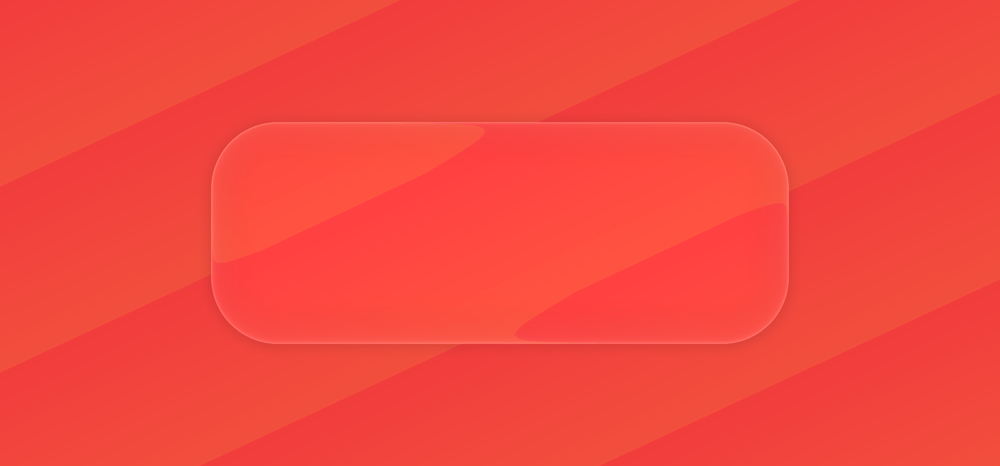

### Specular highlights

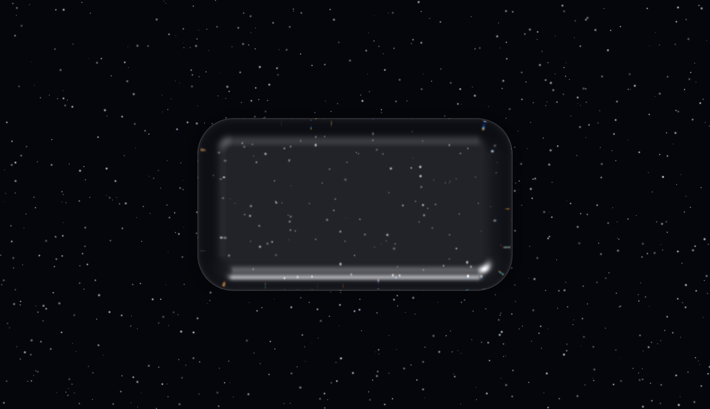

### Dome magnifier vs biconvex pill

Two bevel models over the same text: biconvex (left) refracts at both surfaces,
the plano-convex dome (right) acts as a magnifier.

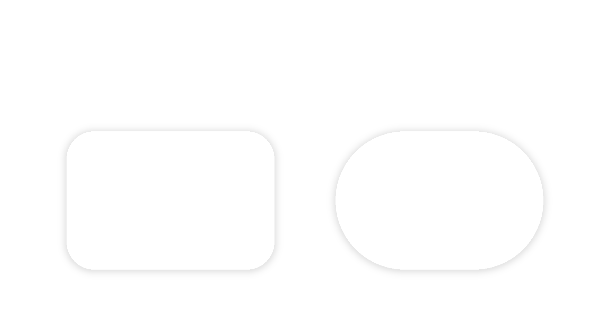

### Dome magnifier over text

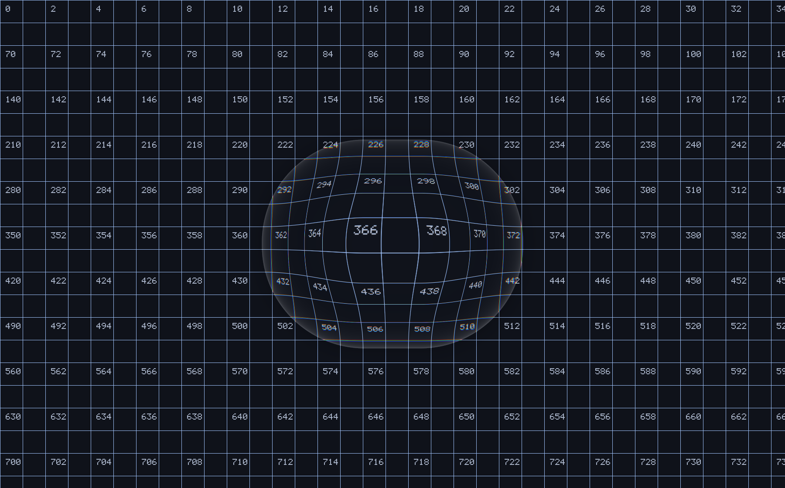

### Glass on glass

The upper panel bends the lower panel's already-shaded output, because a panel
samples everything painted before it.

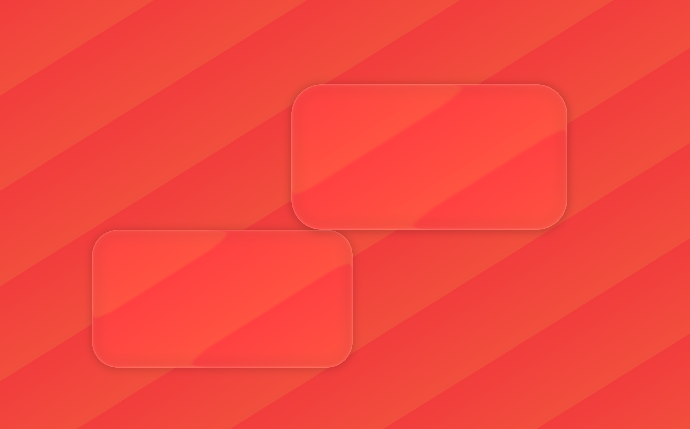

### Large surface

A sidebar-shaped sheet. Large panels need low refraction, or the content behind
them turns into a funhouse mirror.

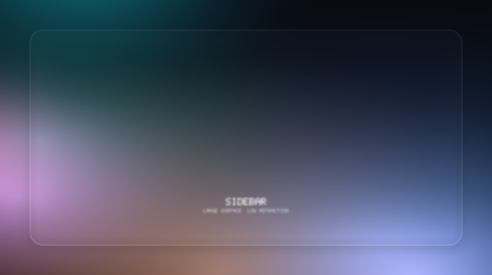

---

## Demos

### Run the render CLI (any platform, including Linux)

```bash
swift build -c release --product liquidglass-render
.build/release/liquidglass-render --list
.build/release/liquidglass-render --scene hero --out /tmp/hero.png --scale 2
```

### Run the interactive SwiftUI demo (macOS)

```bash
swift run -c release liquidglass-demo
```

The app puts the component set over a gradient with live sliders for refraction,
blur, chromatic aberration, specular, radius, shape, and bevel mode, so you can
watch each term of the model change the material.

### Verify the port against the reference (needs Chromium)

```bash
./scripts/verify-crosscheck.sh
```

This renders the same ten cases through this port and through the real
`@ybouane/liquidglass` in headless Chromium, samples 37 pixels per case, and
fails if any channel is more than 2/255 off. Current result:

```
[PASS] default            37 samples, worst delta 0
[PASS] specular           37 samples, worst delta 0
[PASS] blur               37 samples, worst delta 1
[PASS] tint               37 samples, worst delta 0
[PASS] chroma             37 samples, worst delta 2
[PASS] dome               37 samples, worst delta 1
[PASS] shadow             37 samples, worst delta 1
[PASS] opacity            37 samples, worst delta 2
[PASS] sharp              37 samples, worst delta 0
[PASS] small-pill         37 samples, worst delta 2

compared 370 samples across 10 cases, tolerance 2
PASS: every sample within 2 of the reference implementation
```

Four of the ten cases are pixel-exact; the rest differ by at most 2/255 in one
channel, which is float-rounding noise.

---

## Install

```swift
.package(url: "…/liquid-glass-ventura.git", from: "1.0.0")
```

```swift
.target(name: "MyApp", dependencies: [
    .product(name: "LiquidGlass", package: "liquid-glass-ventura"),
])
```

Requires Swift 5.9. The package builds on Linux too — the `LiquidGlassCore`
target and the render CLI have no Apple framework dependency, which is how the
screenshots and the cross-check run without a Mac.

## Usage

### The SwiftUI modifier

```swift
import SwiftUI
import LiquidGlass

// A capsule of the regular material.
Text("Hello").padding().liquidGlass()

// The clear material — less blur, more refraction, so media stays readable.
Image("photo").liquidGlass(.clear, in: .rect(cornerRadius: 24))

// A capsule of a raw config, for full control of the optics.
myView.liquidGlass(config: .panel, in: .capsule)
```

`liquidGlass` takes a `GlassShape` (`.capsule`, `.rect(cornerRadius:)`,
`.circle`) or any SwiftUI `Shape`. On macOS 26 and later it forwards to the
system `glassEffect`; on Ventura through macOS 15 it draws the ported model.

The native path is behind `#if compiler(>=6.2)`, not only `#available`. The
system `glassEffect` symbol only exists in the SDK that ships with Xcode 26, so
building this package with an older toolchain — the normal case on Ventura,
Sonoma, and Sequoia — compiles the ported path only and never references a
symbol that toolchain does not have. That is what makes the package build on the
same machines it supports.

### Button styles

```swift
Button("Cancel") {}.buttonStyle(.liquidGlass)
Button("Confirm") {}.buttonStyle(.liquidGlassProminent)
Button("Clear") {}.buttonStyle(.liquidGlassClear)
```

These are spelled `.liquidGlass…` rather than `.glass…` because Apple's `.glass`
and `.glassProminent` already exist on macOS 26, and redeclaring those names on
`ButtonStyle` would make `.buttonStyle(.glass)` ambiguous for anyone building
against that SDK. `LiquidGlassButtonStyle.glass` and
`LiquidGlassButtonStyle.glassProminent` are available if you want the Apple
spelling explicitly.

### Choosing a backdrop

The optical model needs the pixels behind the panel in order to refract them.
How those pixels are obtained differs by host, so you pick:

```swift
.liquidGlass(.regular, in: .capsule, backdrop: .nativeBlur)          // default
.liquidGlass(.regular, in: .capsule, backdrop: .image(wallpaper))
.liquidGlass(.regular, in: .capsule, backdrop: .color(.black))
```

| Backdrop | What it does | When to use it |
| --- | --- | --- |
| `.nativeBlur` | `NSVisualEffectView` draws the blur; the ported rim, edge highlight, specular, and tint are composited on top | The default. Needs no snapshot and cannot pick up content drawn in front of the glass |
| `.image(_:)` | Refracts a `CGImage`, such as the desktop wallpaper | Exact reference behaviour; every pixel behind the panel is sampled |
| `.color(_:)` | Refracts a flat colour | Previews and tests |
| `.view(_:)` | Refracts a live `NSView` | AppKit hosts, where the glass sits behind a known view |

`.nativeBlur` is the default because capturing a window in SwiftUI also captures
the content drawn *on top* of the glass, which would bend a ghost of the label
into the material. `.image` and `.view` are the exact paths, and both are
correct as long as the backdrop they read really is behind the glass.

### AppKit

```swift
let glass = GlassView(frame: rect, config: .panel)
glass.cornerRadius = 24
container.addSubview(glass)   // add first, then the content it refracts
```

`GlassView` reads the hierarchy behind it by asking the superview to redraw the
region it covers with itself hidden, which is the correct arrangement in AppKit.
Set `wallpaperBackdrop = true` to refract the desktop wallpaper instead.

### Configs

`GlassConfig` is a one-to-one port of the reference library's option set, so a
config authored for the web produces the same optics here. All 20 options:

| Option | Default | Meaning |
| --- | --- | --- |
| `blurAmount` | `0` | Background blur, `0` sharp to `1` maximum |
| `refraction` | `0.69` | How far the glass bends the image behind it |
| `chromAberration` | `0.05` | Colour fringing at the edges |
| `edgeHighlight` | `0.05` | Inner rim lighting |
| `specular` | `0` | Multi-light Blinn-Phong highlight |
| `fresnel` | `1` | Reflection at grazing angles |
| `distortion` | `0` | Micro-distortion noise |
| `cornerRadius` | `65` | Corner radius in points |
| `zRadius` | `40` | Bevel depth |
| `opacity` | `1` | Overall panel opacity |
| `saturation` | `0` | `-1` desaturated, `0` neutral, `1` vivid |
| `tintStrength` | `0` | Cool blue glass tint |
| `brightness` | `0` | Brightness shift, nominally `-0.5 … 0.5` |
| `shadowOpacity` | `0.30` | Drop shadow opacity |
| `shadowSpread` | `10` | Drop shadow spread in points |
| `shadowOffsetY` | `1` | Drop shadow vertical offset |
| `floating` | `false` | Surface can be dragged |
| `button` | `false` | Hover brightens, press flattens |
| `bevelMode` | `.biconvex` | `.biconvex` or `.dome` |
| `tintColor` | `nil` | Extra colour tint on top of the cool glass |

Named presets: `.standard`, `.panel`, `.chip`, `.magnifier`, `.materialRegular`,
`.materialClear`, `.materialButton(prominent:clear:circle:)`.

## Architecture

```
Sources/
  LiquidGlassCore/     pure Swift, no platform frameworks — builds on Linux
    GlassConfig.swift      the 20-option model, one-to-one with the reference
    GlassMath.swift        rounded-rect SDF, bevel height field, refraction
    SoftwareGlassRenderer  the CPU rasteriser: blur, chromatic dispersion,
                           Fresnel, Blinn-Phong. Both the CLI and the SwiftUI
                           layer draw through this, so the screenshots show
                           exactly what ships
    GlassScene.swift       layers, z-order, glass-on-glass compositing
    StackingContext.swift  the browser's two-pass painting-order rule
    GlassClusterer.swift   which nearby surfaces share one merged panel
    CrossCheck.swift       the case list shared with the reference harness
    DemoScenes.swift       the twelve scenes behind docs/screenshots
    Color.swift / Geometry.swift / RGBAImage.swift
    PNGEncoder.swift       dependency-free DEFLATE + PNG writer
    Wallpaper.swift        procedural test backdrops
    TextRasterizer.swift   built-in bitmap font for labels
  LiquidGlass/         the Apple layer (macOS only)
    GlassEffect.swift          the `liquidGlass` modifiers
    LiquidGlassMaterial.swift  `.regular`, `.clear`, and their configs
    GlassSurfaceView.swift     native blur + ported optics + shadow
    GlassButtonStyles.swift    the button styles
    GlassView.swift            the AppKit view
    GlassEffectContainer.swift the container: merged panels on 13–15, system
                               pass-through on 26+
    GlassEffectIdentity.swift  ids, unions, and transitions
    GlassBackdrop.swift        backdrop capture, CGImage <-> RGBAImage
    GlassShape.swift           shape -> corner radius, path, SwiftUI shape
  liquidglass-render/  the CLI that produces docs/screenshots
  LiquidGlassDemo/     the interactive SwiftUI demo app
```

The two layers exist so the optics are testable without a Mac. `LiquidGlassCore`
is 110 tests plus the cross-check harness; `LiquidGlass` is a thin shell that
feeds it a backdrop and draws the result.

## Credits

This is a port, not an original work. The optical model, the parameter set, the
shader constants, and the compositing behaviour all come from:

- **[@ybouane/liquidglass](https://github.com/ybouane/liquidglass)** by
  **[ybouane](https://x.com/ybouane)** — the WebGL library this ports. The
  GLSL in `src/shaders.ts` is the specification for everything in
  `LiquidGlassCore`. Live demo: <https://liquid-glass.ybouane.com/>.
  See also [tiltshift-in-html](https://github.com/ybouane/tiltshift-in-html).

Reference material that shaped the SwiftUI API surface:

- **[fang2hou/ai-coding-guidelines](https://github.com/fang2hou/ai-coding-guidelines/blob/main/guidelines/en/platforms/liquid-glass-api.md)**
  — the system Liquid Glass API contract, used to keep the modifier and button
  signatures shaped the way Apple's are.
- **[Dimillian/Skills — swiftui-liquid-glass](https://github.com/Dimillian/Skills/blob/main/swiftui-liquid-glass/SKILL.md)**
  — SwiftUI usage patterns for the system material.
- **[conorluddy/LiquidGlassReference](https://github.com/conorluddy/LiquidGlassReference)**
  — a reference implementation and notes on the material's look.
- **[GetStream/awesome-liquid-glass](https://github.com/GetStream/awesome-liquid-glass)**
  — the wider catalogue of Liquid Glass work, used to check the port against
  what the community had already learned about the material.

Apple's own `glassEffect`, `GlassEffectContainer`, `Glass`, and the glass button
styles are the API this package mirrors on macOS 26 and later. Liquid Glass as a
design language belongs to Apple.

### What is intentionally different

One compositing case is deliberately *not* faithful. The reference library's
WebGL canvas stores `rgb * alpha` and `alpha²`, so a translucent panel composites
as `rgb * alpha + backdrop * (1 - alpha²)`. `GlassConfig.referenceAlphaCompositing`
reproduces that by default so translucent panels match the reference exactly;
set it to `false` for textbook straight-alpha source-over. That single divergence
is marked parity-exempt in the cross-check and excluded from the 370-sample diff.

## License

MIT.
